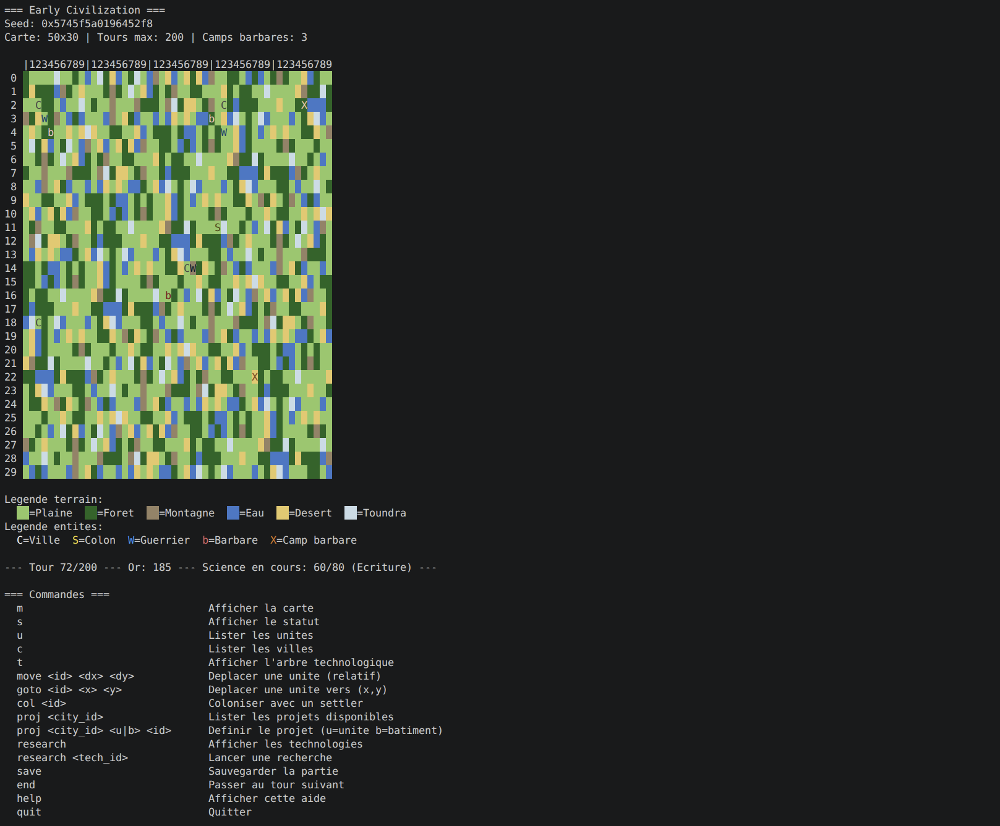
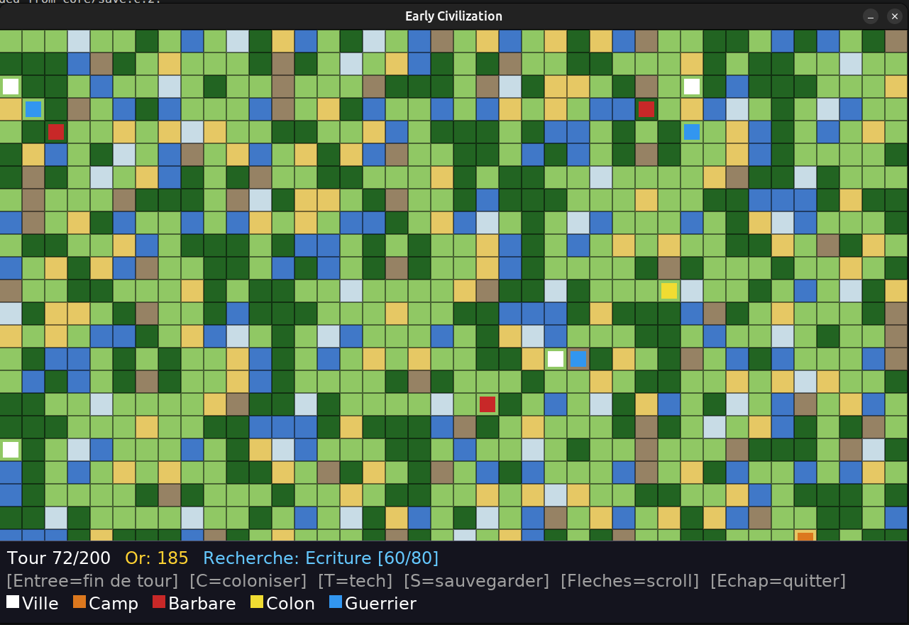

# Early Civilization

Projet PP2I - 1A Telecom Nancy 2025-2026  
Sujet : Civilization

**Membres du groupe :**  
Lydéric SINGER, Jules GOETZ

---

## Sommaire

- [Early Civilization](#early-civilization)
  - [Sommaire](#sommaire)
  - [C'est quoi](#cest-quoi)
  - [Dépendances](#dépendances)
  - [Compilation et lancement](#compilation-et-lancement)
  - [Mode CLI](#mode-cli)
  - [Mode SDL](#mode-sdl)
  - [Déroulement d'une partie](#déroulement-dune-partie)
  - [Mécaniques de jeu](#mécaniques-de-jeu)
    - [Terrains](#terrains)
    - [Unités](#unités)
    - [Note sur la science](#note-sur-la-science)
    - [Villes](#villes)
    - [Bâtiments](#bâtiments)
    - [Technologies](#technologies)
    - [Conditions de fin de partie](#conditions-de-fin-de-partie)
  - [Sauvegarde et chargement](#sauvegarde-et-chargement)
  - [Barbares](#barbares)
  - [Tests](#tests)
  - [Architecture](#architecture)
  - [Documentation de projet](#documentation-de-projet)
  - [Limites connues](#limites-connues)

---

## C'est quoi

Un jeu de stratégie au tour par tour en C, inspiré de Civ. La carte est générée depuis une seed, les villes grandissent, les barbares attaquent, et on gagne en recherchant toutes les technologies ou en dominant le territoire assez longtemps. Deux modes de jeu : CLI avec couleurs ANSI dans le terminal, et SDL2 avec une fenêtre graphique.

---

## Dépendances

- `clang`
- `libsdl2-dev`
- `libsdl2-ttf-dev`
- `pkg-config`

`clang` doit être installé séparément. Les bibliothèques SDL2 s'installent sur Ubuntu/Debian avec :

```bash
make req
# ou manuellement :
sudo apt-get install libsdl2-dev libsdl2-ttf-dev
```

---

## Compilation et lancement

```bash
make          # compile tout
make cli      # lance en mode terminal
make sdl      # lance en mode graphique
make test     # lance les tests unitaires
make clean    # supprime les .o et l'exécutable
make reset    # clean + supprime les sauvegardes et scores
```

L'exécutable accepte aussi des arguments directement :

```bash
./civ [options]
```

| Option | Raccourci | Défaut | Description |
|--------|-----------|--------|-------------|
| `--width W` | `-W W` | 50 | Largeur de la carte |
| `--height H` | `-H H` | 30 | Hauteur de la carte |
| `--turns N` | `-t N` | 200 | Nombre de tours max |
| `--barbarians N` | `-b N` | 3 | Nombre de camps barbares |
| `--seed N` | `-s N` | aléatoire | Graine (entier, chaîne quelconque, ou `0x` + 16 chars hex) |
| `--mode MODE` | `-m MODE` | cli | Mode : `cli` ou `sdl` |

Exemple :

```bash
./civ --mode sdl --width 40 --height 25 --turns 150 --barbarians 5 --seed 1234567890
```

---

## Mode CLI



La carte s'affiche en couleurs ANSI directement dans le terminal (truecolor requis). Les commandes se tapent en bas de l'écran.

| Commande | Description |
|----------|-------------|
| `m` | Affiche la carte |
| `s` | Affiche le statut (or, tour, score) |
| `u` | Liste les unités |
| `c` | Liste les villes |
| `t` | Affiche l'arbre technologique |
| `move <id> <dx> <dy>` | Déplace une unité d'un delta relatif (dx, dy) |
| `goto <id> <x> <y>` | Déplace automatiquement une unité vers (x, y) |
| `col <id>` | Colonise la case actuelle avec un settler |
| `proj <city_id>` | Liste les projets disponibles pour la ville |
| `proj <city_id> <u\|b> <id>` | Choisit un projet (u=unité, b=bâtiment) |
| `research` | Affiche l'arbre technologique avec disponibilité |
| `research <tech_id>` | Lance une recherche |
| `save` | Sauvegarde la partie |
| `end` | Passe au tour suivant |
| `quit` | Quitte sans sauvegarder |
| `help` | Affiche l'aide |

---

## Mode SDL



La carte s'affiche dans une fenêtre graphique avec caméra déplaçable. On clique sur les unités et les villes pour les sélectionner. Un panneau affiche les infos de ce qui est sélectionné.

| Touche/Action | Description |
|--------------|-------------|
| Flèches directionnelles | Déplace la caméra |
| Clic gauche | Sélectionne l'unité ou la ville sous le curseur |
| `S` | Sauvegarde |
| `T` | Ouvre le menu des technologies |
| `C` | Colonise (si un settler est sélectionné) |
| Entrée | Valide un menu / passe au tour suivant |
| Échap | Ferme un menu / quitte |

---

## Déroulement d'une partie

Le joueur démarre au centre de la carte avec une ville et un Warrior. La partie se joue au tour par tour.

Chaque tour se déroule dans cet ordre :

1. **Phase d'action** : le joueur déplace ses unités, donne des ordres de production à ses villes, et choisit une technologie à rechercher.
2. **Phase de production** : les ressources sont calculées, les projets de construction et de recherche avancent.
3. **Phase de croissance** : la population de chaque ville augmente ou diminue selon la nourriture disponible.
4. **Phase des barbares** : les unités barbares se déplacent et attaquent les cibles les plus proches.
5. **Fin de tour** : vérification des conditions de victoire et de défaite.

---

## Mécaniques de jeu

### Terrains

| Terrain | Nourriture | Production | Or | Science | Déplacement |
|---------|-----------|-----------|-----|---------|-------------|
| Plaine | 2 | 1 | 0 | 0 | 1 |
| Forêt | 1 | 2 | 0 | 0 | 2 |
| Montagne | 0 | 3 | 0 | 1 | 3 |
| Eau | 1 | 0 | 1 | 0 | infranchissable |
| Désert | 0 | 0 | 1 | 0 | 1 |
| Toundra | 1 | 1 | 0 | 0 | 1 |

### Unités

| Unité | Coût | Entretien | PV | Attaque | Défense | PM |
|-------|------|-----------|-----|---------|---------|-----|
| Settler | 50 | 0 | 10 | 0 | 1 | 2 |
| Warrior | 40 | 1 | 15 | 3 | 2 | 3 |

Le Settler peut être produit dans n'importe quelle ville sans prérequis. Il fonde de nouvelles villes et est détruit lors de la fondation. Le Warrior combat ; pour en produire, il faut avoir recherché l'Artisanat et posséder une Caserne dans la ville. Le joueur démarre la partie avec un Warrior offert gratuitement.

### Note sur la science

La montagne est le seul terrain qui produit de la science (1 par tour). Pour éviter qu'une ville sans montagne dans son rayon reste bloquée à 0 science, chaque ville reçoit un bonus fixe de 2 science par tour. Ce minimum garantit que la recherche peut toujours avancer, même lentement.

### Villes

Chaque ville exploite les cases dans un rayon autour d'elle et génère des ressources (nourriture, production, or, science) selon les terrains couverts. Le rayon d'exploitation dépend de la population :

| Population | Rayon d'exploitation |
|:----------:|:--------------------:|
| 1 à 9 | 1 case |
| 10 à 25 | 2 cases |
| 26 et plus | 3 cases |

Les villes construisent des bâtiments ou des unités. Si l'or passe en négatif, une unité du joueur est dissoute immédiatement ; s'il n'en a plus, la production de toutes les villes est divisée par deux pour ce tour. Si la production totale reste à 0 pendant 5 tours consécutifs, c'est une défaite par banqueroute.

### Bâtiments

| Bâtiment | Coût | Entretien | Bonus | Prérequis |
|----------|------|-----------|-------|-----------|
| Grenier | 30 | 1 | +3 nourriture, seuil de croissance ÷ 1.5 | — |
| Atelier | 40 | 1 | +3 production | — |
| Bibliothèque | 50 | 1 | +4 science | Écriture |
| Marché | 40 | 1 | +3 or | Commerce |
| Caserne | 60 | 2 | permet de recruter des Warriors | — |
| Rempart | 80 | 2 | défense de ville à 30 au lieu de 20 | Maçonnerie |

### Technologies

| ID | Technologie | Coût | Prérequis | Effet |
|----|------------|------|-----------|-------|
| 0 | Chasse | 50 | aucun | +1 nourriture sur les forêts |
| 1 | Agriculture | 60 | aucun | +10% nourriture |
| 2 | Irrigation | 90 | Agriculture | +20% nourriture en plus |
| 3 | Artisanat | 70 | aucun | +10% production, débloque Warrior |
| 4 | Maçonnerie | 100 | Artisanat | débloque Rempart |
| 5 | Écriture | 80 | aucun | +10% science, débloque Bibliothèque |
| 6 | Commerce | 90 | Artisanat + Écriture | +10% or, débloque Marché |
| 7 | Équitation | 100 | aucun | +1 PM à toutes les unités |

Rechercher les 8 technologies donne la victoire scientifique.

### Conditions de fin de partie

Victoires :
- Scientifique : toutes les 8 technologies recherchées
- Territoriale : 10 villes ou plus pendant 5 tours consécutifs

Défaites :
- Capitulation : toutes les villes détruites
- Temps : nombre de tours max atteint
- Banqueroute : production nulle pendant 5 tours consécutifs

---

## Sauvegarde et chargement

Au lancement du jeu (CLI et SDL), un menu propose de démarrer une nouvelle partie, de charger une sauvegarde existante, ou de consulter le tableau des scores des parties terminées.

Les fichiers de sauvegarde sont dans `saves/` au format texte lisible. Chaque fichier contient l'état complet de la partie (carte, unités, villes, technologies, or, graine).

---

## Barbares

Au démarrage, des camps sont posés sur la carte à au moins 5 cases du point de départ du joueur. Chaque camp peut faire apparaître des unités hostiles qui attaquent les villes et unités proches. Le nombre total d'unités barbares en vie est plafonné à 3 fois le nombre de camps initiaux. Détruire un camp rapporte de l'or : 5 or pour le premier, 10 pour le second, 15 pour le troisième, et ainsi de suite.

---

## Tests

```bash
make test
```

17 fonctions de test sur le moteur de jeu, sans dépendance à l'interface :

- distance de Chebyshev
- déterminisme de la graine
- colonisation
- croissance des villes
- famine
- production
- technologies
- combat unité vs unité
- déplacement des unités
- conditions de victoire/défaite
- combat contre une ville
- rendements des technologies
- entretien des unités
- rendements des bâtiments
- victoire territoriale
- sauvegarde et chargement
- tours des barbares

---

## Architecture

```
.
├── main.c              # point d'entrée, parsing des arguments
├── config.h            # toutes les constantes de jeu
├── core/               # moteur de jeu (sans dépendance SDL ou CLI)
│   ├── structs.h       # types (GameState, City, Unit, ...)
│   ├── core.h          # includes globaux du moteur
│   ├── lifecycle.c     # génération de carte, création/destruction du jeu
│   ├── cities.c        # gestion des villes
│   ├── units.c         # unités et déplacements
│   ├── turn.c          # déroulement d'un tour
│   ├── tech.c          # arbre technologique
│   ├── barbarians.c    # IA des barbares
│   ├── save.c          # sauvegarde et chargement
│   └── utils.c         # RNG, heightmap, utilitaires
├── cli/
│   ├── cli.c           # interface terminal
│   └── sdl_ui.c        # interface graphique SDL2
└── tests/
    └── test_main.c     # tests unitaires
```

Le moteur dans `core/` ne connaît ni SDL ni CLI. Les deux interfaces appellent les mêmes fonctions.

---

## Documentation de projet

- `SPEC_TECHNIQUE.md` — spécification technique : structures de données, algorithmes, choix d'architecture, extension implémentée (EXT-4), simplifications assumées

Le dossier `reports/` contient :

- `report1.md`, `report2.md`, `report3.md` — comptes rendus de réunion
- `planning.png` — planning du projet et attribution des tâches (diagramme de Gantt)

---

## Limites connues

- Solo uniquement.
- Pas de zoom en SDL.
- Pas de brouillard de guerre : la carte est entièrement visible dès le début.
- L'IA barbare est greedy : elle fonce vers la cible la plus proche sans anticipation.
- En SDL, les tuiles sont des rectangles de couleur unie, sans sprites ni textures.
- Le mode CLI demande un terminal avec support truecolor. Sur les autres terminaux les couleurs tombent en dégradé 256 couleurs, c'est moins lisible.
- Pas de tutoriel.
